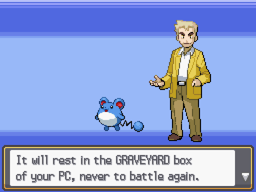
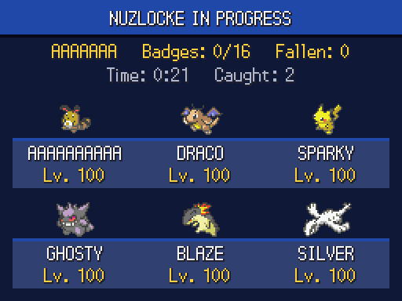
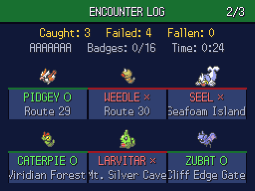
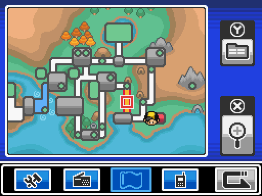
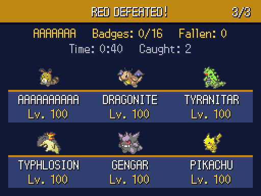
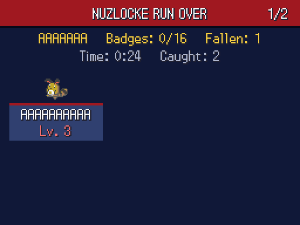

# Pokémon SoulSilver — Nuzlocke Edition

A ROM hack of **Pokémon SoulSilver (Nintendo DS)** with the Nuzlocke challenge built into the game itself. You don't have to keep track of the rules yourself: the game enforces them.

> **This is SoulSilver, the 2010 Nintendo DS remake, not the original Game Boy Color *Pokémon Silver*.** The patch only works on the **USA** version of SoulSilver.

  
  
  

  
  
  

## Features at a glance

- **Encounter rule:** only the first wild Pokémon in each area can be caught. Thrown balls are dodged after that, and the ball isn't used up.
- **Shiny clause:** shinies can always be caught.
- **Permadeath:** fainted Pokémon go to a locked **GRAVEYARD** PC box, and Revives don't work.
- **Forced nicknames:** the naming screen opens after every catch.
- **Wipeout = game over:** a **RUN OVER** screen with your final team, locked for good.
- **No do-overs:** the game autosaves after any battle that matters (a death, a catch, a new area's encounter, a big win), and the soft-reset combo is disabled.
- **Victory screens** for beating the Elite Four and Red, saved so you can view them again later.
- **Records (SELECT):** your current run, an encounter log of every area (○ caught / × failed) and your victories.
- **Pokégear map Nuzlocke view:** point at any route to see what you met there and whether you caught it.
- **Professor Oak explains the rules** in his opening speech.
- **Test mode:** a hidden shortcut to try the endgame screens without touching your save.

See **[FEATURES.md](FEATURES.md)** for the full list and exact rules.

## How to play

You need:
1. Your own legally dumped **Pokémon SoulSilver (USA)** ROM. No ROMs are provided here.
2. The patch: [`patch/SoulSilver_Nuzlocke.xdelta`](patch/SoulSilver_Nuzlocke.xdelta)
3. A DS emulator, such as Delta (iPhone/iPad), melonDS or DeSmuME.

**Quick version:** open [Rom Patcher JS](https://www.marcrobledo.com/RomPatcher.js/), choose your SoulSilver ROM and the `.xdelta` patch, click **Apply patch**, then load the result in your emulator and start a **New Game**.

Full step-by-step instructions, including checksums and Delta setup, are in **[docs/INSTALL.md](docs/INSTALL.md)**.

| File | CRC32 |
|---|---|
| Original SoulSilver (USA) ROM | `D8EA6090` |
| Patched Nuzlocke ROM | `2E2E3EA9` |

## Controls added by the hack

| Where | Button | What it does |
|---|---|---|
| Overworld | **SELECT** | Open Nuzlocke records (A/→ next, ← back, B close) |
| Pokégear map | **SELECT** | Switch between normal and Nuzlocke view |
| Overworld | Hold **L + SELECT** for 5 s | Test mode: fight Champion Lance |
| Overworld | Hold **R + SELECT** for 5 s | Test mode: fight Red |

## Building from source

The hack is built on [pret/pokeheartgold](https://github.com/pret/pokeheartgold), a decompilation of HeartGold/SoulSilver. The full source changes are in [`source/nuzlocke_source.diff`](source/nuzlocke_source.diff). See **[docs/BUILDING.md](docs/BUILDING.md)** to rebuild the patch, or to switch individual rules on or off.

How it works under the hood (save layout, hooks, screens): **[docs/TECHNICAL.md](docs/TECHNICAL.md)**.

## Credits

- **[pret/pokeheartgold](https://github.com/pret/pokeheartgold)**: the HeartGold/SoulSilver decompilation this hack is built on.
- The Nuzlocke challenge was created by Nick Franco.
- Pokémon © Nintendo / Creatures Inc. / GAME FREAK inc. This is an unofficial fan project, not affiliated with or endorsed by them. Don't share ROMs: only the patch is distributed here.
